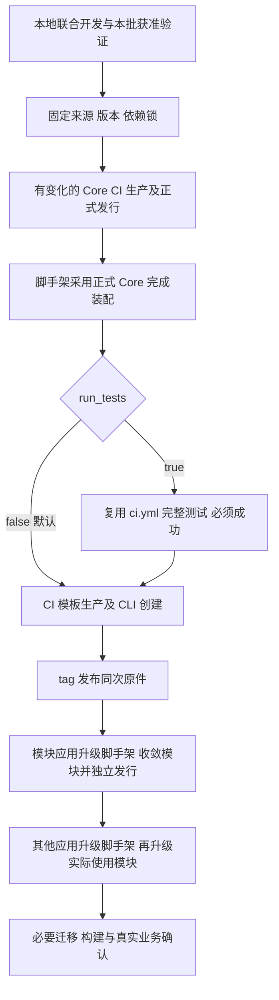

# Core 独立发行与资格原件交接

本文由 Code 维护跨仓发行流程，属于源码仓维护者资料，不随 APP 分发，也不是应用开发前置；两 Core 的生产输入和包级实现分别以其原生入口为准。脚手架、PHP Core、Web Core 独立版本，不因脚手架升版重新发行未变化的 Core；Web 六包及包间依赖保持同号。历史演练与故障过程使用 Git 历史追溯，不作为现行操作步骤。版本、main/tag、正式发行和生产操作仍须各自授权。

## 真实入口与职责

| 对象 | 开发、生产及资格入口 | tag 发行入口与固定原件 |
| --- | --- | --- |
| PHP Core `peanut-admin/core` | [README](https://github.com/peanut-business/peanut-admin-core-php/blob/main/README.md)、`scripts/release-identity`、[ci.yml](https://github.com/peanut-business/peanut-admin-core-php/blob/main/.github/workflows/ci.yml) | [release.yml](https://github.com/peanut-business/peanut-admin-core-php/blob/main/.github/workflows/release.yml)；仓库变量 `CORE_QUALIFICATION_RUN_ID` 指定成功 CI 的 `php-core-qualified` |
| Web Core 六包 | [README](https://github.com/peanut-business/peanut-admin-core-web/blob/main/README.md)、`scripts/release-identity.mjs`、[ci.yml](https://github.com/peanut-business/peanut-admin-core-web/blob/main/.github/workflows/ci.yml) | [release.yml](https://github.com/peanut-business/peanut-admin-core-web/blob/main/.github/workflows/release.yml)；同名仓库变量指定成功 CI 的 `web-core-qualified` |
| Code 脚手架 | [发行生产者合同](../maintenance/release-producers.md)；本地 `peanut release` 用于开发，CI 生产正式模板 | 本仓 `scaffold-release.yml`；同一精确来源 S 的成功模板生产 run 与原 transport，完整应用 CI 默认不跑、`run_tests=true` 必须成功，不能用 Core 变量替代 |

Web 六包为 `@peanut-admin/client`、`vue`、`ui-vue`、`nuxt`、`uniapp`、`testing`。PHP 版本来自 Git tag，`composer.json` 不嵌入版本；Web 根清单、六包清单、包间依赖及版本声明须与 tag 一致。渠道状态核实时公开版本、来源和字节，不把开发分支、旧演练或 README 中的版本描述当作最新发行事实。

## 开发到正式发行的顺序

1. **开发。** 先读已有实现和直接消费者，集中闭合已知问题、依赖和必要派生；日常联调使用既有 Core 源码选择与 watch，不为每个修复发包。
2. **本地包与按需验证。** 先完成本次直接必要运行检查及已授权测试，再安排正式发行。本地归档、输入 seal、identity 比较、业务路径和完整资格分别报告；本地包可用于开发消费，不能自行写成 qualified 或已正式发行。
3. **CI 正式生产。** 固定源码 S、版本、实际原生锁和生产输入，在各 Core 的 `ci.yml` 选择默认 `mode=production`，提供 `expected_source_commit=S`，只生产一次正式包并完成原生包消费检查。完整测试使用独立选择的 `mode=qualification`，不要求两种模式先后各跑一次；已有同源、同合同且原件可取的成功 production 或 qualification run 直接复用。production 如实记录完整测试 NOT_RUN，不将本地结果改成 CI PASS。`mode=identity` 仍只比较两轮标准产物，不授予发行资格。PHP 另提供不带 v 的 `release_version`。
4. **正式 tag 发布。** 将本仓变量 `CORE_QUALIFICATION_RUN_ID` 固定到已核成功 run，核原件可取、未过期及适用输入；完成获准的源码集成后，推送指向当时当前 main 的注释 `vX.Y.Z`。tag 工作流只核资格、读取原包、发布并核公共渠道，不重新开发、构建、制包或运行原资格测试。发布端必要工具准备、原锁安装和渠道字节核验不因此省略。
5. **应用采用与首装。** 正式渠道闭合后，应用另行选择精确版本及来源、更新自身锁并按变化确认业务；Core 发行成功不表示下游已升级。正式发行任务不顺手升级其他应用。脚手架公开渠道首装后验在发行后独立安排和记录，不反过来伪造发行前已完成，也不为此重复生产发行原件。

普通分支推送不自动启动 CI。完整测试只按明确授权开展；正式发行保留必要的原生包消费和渠道验证。CI 测试选择不改变本地开发期的按需测试政策。包合格不代表完整测试通过，缺失正式原件只阻相应发行，不阻普通开发；当前入口不是跨源码复用任意测试组的增量引擎。

### CI 完整测试参数

脚手架在既有 `scaffold-release.yml` 中使用一个布尔参数 `run_tests`，默认 `false`：

| 使用阶段 | `false`（默认） | `true` |
| --- | --- | --- |
| 模板生产 `publish=false` | 跳过完整应用测试，执行原有模板生产与 CLI 创建检查 | 先通过 reusable 调用同一源码的既有 `ci.yml`；其完整检查成功后才生产模板，失败、取消或缺失结果均阻断生产 |
| 发布 `publish=true` | 核原生产 run；存在有效测试结果时照实记录 | 必须核到原生产 run 内成功的完整 CI，或 `ci_run_id` 指定的同源成功 `ci.yml`；缺失或失败即拒绝发布，不在发布阶段补跑测试 |

生产时仍填写精确 `expected_source_commit`；`run_tests` 不是本地测试参数，也不触发本机测试。生产 run 内的完整 CI 结果由 main 的手动发布器按原 run/attempt 直接读取；Code 的 Tag 只固定来源，不再自动派发模板生产；`ci_run_id` 可以指向包含完整 CI 的原生产 run 或独立成功 `ci.yml`。发布清单分别记录是否要求完整 CI、实际成功 run 和实际结果，不能把 `false` 写成测试 PASS。两 Core 沿用现有 `mode=production`（默认）或 `mode=qualification`（显式完整测试），不新建另一套入口。参数只决定 CI 是否执行完整测试，不授予正式发行、生产部署或本地测试授权。

原选择保存在现有 `candidate-inputs.json` 的 `run_tests` 布尔字段，受原 candidate-stage 的输入摘要约束；发布器核 transport 时仍执行该要求，不能通过手动传 false 取消。局部重跑沿同一个 run 查询所有 attempts，使用最新完整 CI summary；不因只重跑制包而漏掉前次已成功测试，也不把查不到结果当作默认未测。原选择要求测试但没有可认证成功结果时停止发布。

## 固定原件与当前接入边界

PHP 原生生产顺序为 `scripts/release-identity inputs` → `resolve` → `prepare`；Web 在原锁安装后执行 `node scripts/release-identity.mjs inputs` → `build` → `pack`。输入 seal、实际锁、包摘要与消费者结果由已有工具维护，不新增 runner、手写摘要或另一资格台账。生产输入、源码 tree、包字节或合同发生变化，只使实际受影响的证据失效；不能改写旧 seal 接纳新输入。两 Core 的资格读取器允许满足其合同的同树合并提交，但仍核真实 Git 对象、政策、原包 seal、qualified 与来源 run，不是忽略 commit 归属。

**正式包由一次 CI 生产，Code 的 main 显式发布只消费同一次原件。** 本地包用于开发验证，不上传为正式原件；不设“本地包→GitHub 草稿”的第二条发行路径。保留原 artifact、seal、版本和渠道合同；production 记录包消费 PASS、完整测试 NOT_RUN、`qualified=false`，完整 qualification 才记录 `qualified=true`。既有 `*-core-qualified` artifact 名称只用于定位，发布器读取内容中的实际范围，不能凭名称认定完整测试通过。CI 的 Linux 工具输入与本机开发工具不同，本地验证不必伪装生成 Linux 正式 seal。已有生产入口直接使用，不新增回执录制器、凭据或账本。

Code 要求同一精确 S 的成功 `scaffold-release.yml` 模板生产 run；完整 `ci.yml` 默认不执行，显式 `run_tests=true` 时成为必须通过的前置，不能降级为可选记录。核唯一未过期原件和 transport 摘要。Core 的同树资格规则不自动适用于 Code。本地 `peanut release` 默认支持 dirty/无 HEAD 的 development 快照，也已有 `--source-commit=<S>` 固定来源能力，两者均不改变正式包由 CI 生产的职责。先本地确认，再安排一次 CI 正式生产，受保护 PR 合入 main 后由手动发布消费原件；tag 不触发模板生产或重复测试。transport 是同一次 CI 原件的封装，并非另一套资格包生产。

## 渠道发布与完成判据

- **PHP：** `release.yml` 核注释 tag 指向当前 main、包身份和指定成功 CI，下载 `php-core-qualified`，验证原 ZIP/锁/输入，用原资格锁安装，不重新解析。等待 Packagist 索引精确版本、source/dist reference，下载公开 ZIP 比较规范化路径、类型及逐文件摘要；容器 ZIP 字节可不同，须保留两者摘要。现有 `verify-consumer --public` 使用公开桥接锁确认实际公开 ZIP 可消费，属于渠道桥接确认，不是重跑完整资格。成功后才创建 GitHub Release。
- **Web：** `release.yml` 核当前 main 注释 tag、包版本及仓库身份，下载 `web-core-qualified` 并验证输入和原六包。按 client→vue→ui-vue→nuxt→uniapp→testing 顺序直接发布资格 TGZ，不重新 build/pack 或解析应用依赖；新发布和已存在版本都实际下载 registry tarball 核摘要，不只相信 metadata integrity。六包核对成功后创建 GitHub Release。
- **凭据：** Web 使用已绑定的 npm Trusted Publishing/OIDC，发布 job 有 `id-token:write`，不增加长期 npm token；PHP 依赖已配置的 Packagist 索引渠道。两仓 GitHub Release 使用任务短期 `GITHUB_TOKEN`。Code 的 tag→main dispatch 使用本仓 `actions:write`，main 发布 job 用 `contents:write`；它与 npm OIDC 是不同渠道，不要求本地长期发布凭据。
- **版本：** 稳定版用 `vX.Y.Z`；独立获准的预发行用现有工作流接受的 `vX.Y.Z-rc.N`，Web 预发行使用 npm `rc`，稳定版使用 `latest`。发行后核实际 dist-tag 与版本；首次建包和可信发布者绑定属于渠道设置，不是日常步骤。公开版本不可复用或覆盖。
- **完成：** 原成功资格 run/artifact、tag/main 来源、成功发行 Action、对应公共包精确版本及来源/内容、GitHub Release 均核实才算渠道闭合；部分包公开、Action 启动或仅有 tag 不算完成。应用安装、升级及生产分别记结果。

## 失败与续发

缺变量、失败 CI、identity-only、原件缺失/过期或身份漂移时停止相应发行，不自动改用新包。需要重新资格时先说明具体失效输入或丢失原件，由原资格入口取得新结果；不能在正式 tag job 内临时开发、重包、补测或补写历史字段。

Web 六包发布不是原子事务。失败/UNKNOWN 先对账原 run、已公开包和待核 tarball；同一 tag 仍满足当前 main 和原资格合同时，原 workflow 的重跑可核已存在且字节一致的版本后续发剩余包，不覆盖已发版本、不重跑资格。PHP 同样沿原 run 和公开桥接结果核实。若源码/main 或包内容必须改变，保留旧 tag/原件/失败证据，按新输入及必要授权选择新版本，不移动旧 tag。发行成功后的文档整理不触发未变化 Core 重新发包。

## Core 到脚手架与应用的交接

核 Core 注释 tag、精确源码、成功发行 Action、公共包/来源/摘要和 GitHub Release 后，在 Code 的最终候选准备中使用 `scripts/prepare-product-release-candidate`，显式固定产品版本及两个 Core 的版本/reference。可用的 `--core-web-package-evidence` 与摘要只替代六包元数据读取，不替代真实公开包或消费者资格。依赖及模块锁先收敛，再生成 API/legal/inventory，固定最终 S 后生成一次所需模板资格；正式发布消费原 transport，具体以[发行生产者合同](../maintenance/release-producers.md)为准。

本地冻结组合仍走[冻结内部候选](../maintenance/release-producers.md#冻结内部候选)，保留 development 来源及不可正式发行标记，不要求先公开 Core。已有 APP 的采用、定制冲突、业务确认和首次安装使用各自原生入口及授权；不为 Core 或脚手架发行批量升级下游。

联合开发与正式采用分开：通用技术机制在所属 Core 修复，脚手架负责装配；共享业务在所属 Module 修复，应用专属业务留应用。开发阶段显式引用本地 Core 和模块源码联调，集中收敛本批问题，不为每次修改先发行上游。正式采用按实际依赖顺序推进：有变化的 Core 正式发行 → 脚手架锁定正式 Core 并完成装配、正式发行 → 模块生产应用升级脚手架并收敛模块 → 有变化的模块独立发行 → 其他应用先升级脚手架，再升级实际使用模块，按变化完成必要迁移、构建与业务确认。未变化的对象不跟随重发。

模块生产应用同时是脚手架消费者和模块作者：它可以提前参与本地联调，模块正式发行前确认最终正式依赖组合；自己的模块源码继续作为作者源，不通过升级同一制品覆盖回来。其他模块依实际依赖升级。模块是否已有 CI 自动发行必须读取其实际入口，不因本流程图而假定已具备；未接通的发行能力另外安排。下游可以提前做只读 plan，实际采用不能把本地 development 包或未发行模块当正式版本。每批先收敛依赖与模块锁，再由原生入口生成受影响 API/inventory、执行必要准备；不逐模块重复全套构建，不覆盖应用定制或改写 baseline。

